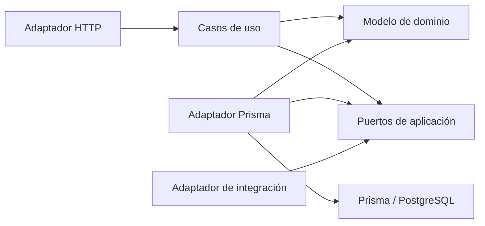

# nest-ddd-hexagonal

Proyecto educativo para aprender **Domain-Driven Design (DDD) y arquitectura hexagonal con TypeScript y NestJS**. Es una API REST construida como un monolito modular, con PostgreSQL y Prisma como adaptadores de persistencia.

El objetivo es comprender dónde colocar cada responsabilidad, cómo orientar las dependencias y cómo probar el núcleo de la aplicación sin depender del framework o de una base de datos. Los módulos `service-orders` y `visits` proporcionan ejemplos concretos para practicar estas decisiones.

El repositorio evoluciona durante el aprendizaje. Las decisiones documentadas describen la implementación actual y sus límites, y sirven como material de estudio.

## Qué se practica

- Modelar comportamiento e invariantes con entidades, un agregado, un objeto de valor y un servicio de dominio.
- Coordinar operaciones mediante casos de uso independientes de NestJS.
- Definir puertos y conectar adaptadores HTTP, Prisma e integración entre módulos.
- Componer las dependencias en módulos de Nest mediante tokens y fábricas.
- Separar modelos de dominio, DTOs HTTP y registros de persistencia.
- Persistir eventos con Outbox y detectar escrituras concurrentes en un agregado.
- Probar reglas, casos de uso y contratos de adaptadores con distintos niveles de aislamiento.

## Arquitectura y dirección de dependencias

Cada módulo organiza su código en tres capas:

| Capa             | Responsabilidad                                      | Ejemplos del repositorio                                                    |
| ---------------- | ---------------------------------------------------- | --------------------------------------------------------------------------- |
| `domain`         | Representar conceptos y proteger reglas del negocio  | `ServiceOrder`, `Technician`, `Visit`, `TimeSlot`, `TechnicianAvailability` |
| `application`    | Coordinar operaciones y declarar contratos de salida | Casos de uso y puertos de repositorio, consulta e integración               |
| `infrastructure` | Adaptar tecnologías y contratos externos al núcleo   | Controladores, DTOs, repositorios Prisma y adaptador entre contextos        |

El núcleo está formado por `domain` y `application`. Estas capas usan TypeScript y APIs estándar de Node.js; no importan NestJS, Prisma ni adaptadores de infraestructura.

El siguiente diagrama representa dependencias de código. La flecha significa «depende de»:



Durante una solicitud, el flujo puede ir desde el controlador hasta PostgreSQL. La dirección de las dependencias permite que el caso de uso invoque un repositorio a través de un puerto sin importar su implementación Prisma. Esto es **inversión de dependencias**.

Los controladores llaman directamente a los casos de uso y actúan como adaptadores de entrada. Los contratos de salida sí se expresan mediante interfaces; no hay una interfaz de entrada adicional para cada caso de uso.

## Estructura del proyecto

```text
src/
├── main.ts                         # Bootstrap HTTP y configuración global
├── app.module.ts                   # Composición de la aplicación
├── app.controller.ts               # Endpoint de estado
├── shared/
│   ├── domain/                     # AggregateRoot, DomainError y DomainEvent
│   └── infrastructure/
│       ├── http/                   # Traducción de errores a HTTP
│       └── prisma/                 # Cliente Prisma y ciclo de conexión
└── modules/
    ├── service-orders/
    │   ├── domain/                 # Modelo, eventos y errores
    │   ├── application/
    │   │   ├── ports/
    │   │   └── use-cases/
    │   ├── infrastructure/
    │   │   ├── http/               # Controlador y DTOs
    │   │   └── persistence/        # Repositorio y consultas Prisma
    │   └── service-orders.module.ts
    └── visits/
        ├── domain/                 # Modelos, errores y servicio de dominio
        ├── application/
        │   ├── ports/
        │   └── use-cases/
        ├── infrastructure/
        │   ├── http/               # Controladores y DTOs
        │   ├── persistence/        # Repositorios Prisma
        │   └── integration/        # Adaptador hacia service-orders
        └── visits.module.ts

prisma/                             # Esquema y migraciones SQL
test/                              # Tests de dominio, aplicación y adaptadores
.github/workflows/ci.yml             # Tests y build en CI
```

`shared` reúne mecanismos compartidos. Los modelos específicos permanecen dentro de su contexto; no existe un repositorio genérico compartido para todas las entidades.

## Cómo se conectan las piezas

Los casos de uso reciben sus dependencias por constructor y no necesitan decoradores de Nest:

```ts
export class RegisterTechnicianUseCase {
  constructor(private readonly repository: TechnicianRepository) {}

  async execute(command: RegisterTechnicianCommand): Promise<string> {
    const technician = Technician.register(command);
    await this.repository.insert(technician);
    return technician.id;
  }
}
```

`TechnicianRepository` es una interfaz de aplicación. `TECHNICIAN_REPOSITORY` es un símbolo que permite identificar esa dependencia durante la ejecución, porque las interfaces de TypeScript no existen en JavaScript.

`VisitsModule` conecta el puerto con el adaptador y construye el caso de uso:

```ts
providers: [
  {
    provide: TECHNICIAN_REPOSITORY,
    useClass: PrismaTechnicianRepository,
  },
  {
    provide: RegisterTechnicianUseCase,
    inject: [TECHNICIAN_REPOSITORY],
    useFactory: (repository: TechnicianRepository) => new RegisterTechnicianUseCase(repository),
  },
];
```

Los módulos de Nest son el punto de composición: conocen las implementaciones concretas y las ensamblan. Los controladores reciben los casos de uso ya construidos.

## Integración entre contextos

Los dos contextos se ejecutan dentro del mismo proceso y comparten una base de datos. Sus modelos y contratos se organizan en módulos separados.

`visits` declara el puerto `ServiceOrderLookup` con la información que necesita del otro contexto. Su adaptador `ServiceOrderLookupAdapter` invoca `GetServiceOrderUseCase`, exportado por `ServiceOrdersModule`, y transforma la respuesta al contrato local.

```text
ScheduleVisitUseCase
    → ServiceOrderLookup
    → ServiceOrderLookupAdapter
    → GetServiceOrderUseCase
```

La dependencia concreta entre contextos queda en la composición y el adaptador de infraestructura. El caso de uso de visitas depende del contrato local. La comunicación actual es síncrona dentro del proceso; no hay microservicios, broker ni consumidores de eventos implementados.

## Decisiones de implementación

### Modelo con comportamiento y casos de uso que coordinan

Las entidades y objetos de valor validan sus invariantes y exponen operaciones. Los casos de uso cargan datos, comprueban condiciones que requieren consultar puertos, invocan el modelo y persisten el resultado.

`ServiceOrder` utiliza `AggregateRoot` para registrar eventos. En `visits`, `TimeSlot` encapsula el intervalo temporal y `TechnicianAvailability` evalúa disponibilidad a partir de los datos que recibe. Los modelos de ese contexto no heredan de `AggregateRoot` ni generan eventos actualmente.

### Validación en las fronteras y dentro del núcleo

Los DTOs usan `class-validator`, `class-transformer` y decoradores de Swagger dentro de `infrastructure/http`. El `ValidationPipe` global transforma entradas y rechaza propiedades no admitidas.

El dominio también valida sus reglas para proteger invocaciones desde otras entradas. Los controladores convierten las fechas HTTP a `Date` cuando corresponde. En visitas, proporcionan `now` al caso de uso; todavía no existe una abstracción de reloj.

`DomainExceptionFilter` traduce códigos de errores del dominio a respuestas HTTP. El núcleo expresa errores sin elegir códigos HTTP.

### Modelos de persistencia separados

Los registros Prisma representan cómo se guardan los datos. Los adaptadores los convierten en modelos de dominio mediante métodos de rehidratación y traducen el modelo al escribir.

En `service-orders`, el repositorio guarda un snapshot del agregado: persiste la raíz y reemplaza las colecciones hijas dentro de una transacción. Esta estrategia simplifica el ejemplo y supone colecciones de tamaño moderado.

### Lecturas según la necesidad de cada contexto

`service-orders` separa el puerto de repositorio para modificar agregados y `ServiceOrderQuery` para obtener vistas y listados. Las consultas Prisma construyen esas vistas sin rehidratar el agregado. El listado usa paginación por cursor.

Es una separación de lectura y escritura dentro de la misma aplicación y base de datos. No incluye buses de comandos ni proyecciones asíncronas. `visits` consulta técnicos mediante su repositorio y no tiene un puerto de lectura separado.

### Concurrencia y Outbox con alcance concreto

El repositorio de `service-orders` aplica control de concurrencia optimista mediante una versión. En cada actualización comprueba e incrementa esa versión dentro de la transacción. El estado persistido del objeto y sus eventos pendientes se reconocen después del commit.

El evento de cierre se guarda en `outbox_events` dentro de la misma transacción que el agregado. Esto permite persistir ambos de forma atómica. El repositorio no incluye un worker que publique esos eventos ni consumidores; el transporte queda pendiente.

Los repositorios de `visits` no implementan ese control de versiones. La programación consulta disponibilidad antes de insertar, sin una transacción que proteja toda la operación. Solicitudes simultáneas pueden competir por un horario o una orden; esas garantías requieren trabajo adicional.

## Estrategia de pruebas

La herramienta de ejecución es **Jest**, con `ts-jest` para TypeScript. **Supertest** permite probar las rutas HTTP de Nest.

| Pruebas actuales          | Qué verifican                                       | Dependencias usadas                          |
| ------------------------- | --------------------------------------------------- | -------------------------------------------- |
| Dominio                   | Comportamiento, invariantes y límites del modelo    | Clases de dominio, sin Nest ni base de datos |
| Aplicación                | Coordinación y errores del caso de uso probado      | Repositorios simulados                       |
| HTTP de visitas           | Rutas, DTOs, códigos HTTP y casos de uso conectados | Nest real y puertos en memoria               |
| Adaptador entre contextos | Traducción del contrato y manejo de errores         | Caso de uso externo simulado                 |
| Persistencia y consultas  | Mapeo, filtros y contrato de las operaciones Prisma | Cliente Prisma simulado                      |

Los tests actuales no requieren PostgreSQL ni cubren un recorrido completo contra una base real. Los tests HTTP abren puertos locales. La suite de CI genera el cliente Prisma, ejecuta tests y compila; no levanta una base de datos.

```bash
npm test -- --runInBand
npm run test:watch
npm run test:cov
```

La existencia de pruebas por capas no implica cobertura exhaustiva de todos los casos de uso ni valida el comportamiento transaccional real de PostgreSQL.

## Ejecutar el proyecto

Requisitos: Node.js 22 o superior, npm y Docker Compose para la base local.

```bash
cp .env.example .env
npm install
docker compose up -d --wait
npm run prisma:generate
npm run db:deploy
npm run start:dev
```

Docker Compose inicia PostgreSQL 16. La API se ejecuta localmente con Nest. `.env.example` contiene la conexión de desarrollo y el puerto predeterminado `3000`.

- Swagger y exploración de rutas: `http://localhost:3000/docs`.
- Estado de la API: `GET http://localhost:3000/api/health`.
- Prefijo global de las rutas: `/api`.

El endpoint de estado devuelve una respuesta estática; no comprueba la conexión a PostgreSQL.

## Comandos de trabajo

| Comando                   | Propósito                                             |
| ------------------------- | ----------------------------------------------------- |
| `npm run start:dev`       | Ejecutar la API con recompilación al cambiar archivos |
| `npm run build`           | Compilar la aplicación                                |
| `npm run lint`            | Revisar el código con ESLint                          |
| `npm run format`          | Aplicar Prettier a los archivos configurados          |
| `npm run prisma:generate` | Generar el cliente desde el esquema Prisma            |
| `npm run db:migrate`      | Crear y aplicar migraciones durante el desarrollo     |
| `npm run db:deploy`       | Aplicar las migraciones existentes                    |
| `npm run db:studio`       | Inspeccionar la base mediante Prisma Studio           |

## Recorrido de lectura sugerido

1. Seguir `RegisterTechnicianDto` → `TechniciansController` → `RegisterTechnicianUseCase` → `Technician` para entender una entrada completa.
2. Revisar `TechnicianRepository`, `PrismaTechnicianRepository` y `VisitsModule` para observar la inversión de dependencias y su composición.
3. Leer `TimeSlot`, `TechnicianAvailability` y `ScheduleVisitUseCase` para distinguir reglas del modelo y coordinación con puertos.
4. Seguir `ServiceOrderLookupAdapter` para estudiar la integración entre contextos.
5. Revisar `ServiceOrder` y su repositorio Prisma para estudiar agregado, rehidratación, concurrencia y Outbox.
6. Comparar los tests de cada capa para identificar qué verifica cada nivel y qué dependencias sustituye.

Al extender el proyecto, ubica cada responsabilidad según su motivo de cambio: reglas en `domain`, coordinación y puertos en `application`, y protocolos o tecnologías en `infrastructure`. Los módulos de Nest conectan esas piezas.
